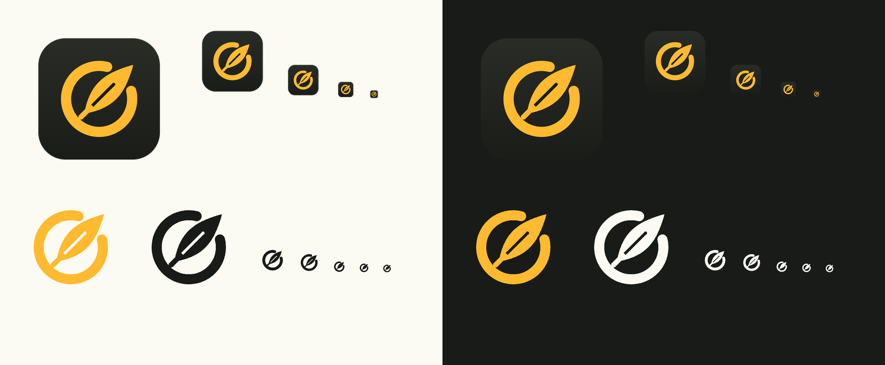
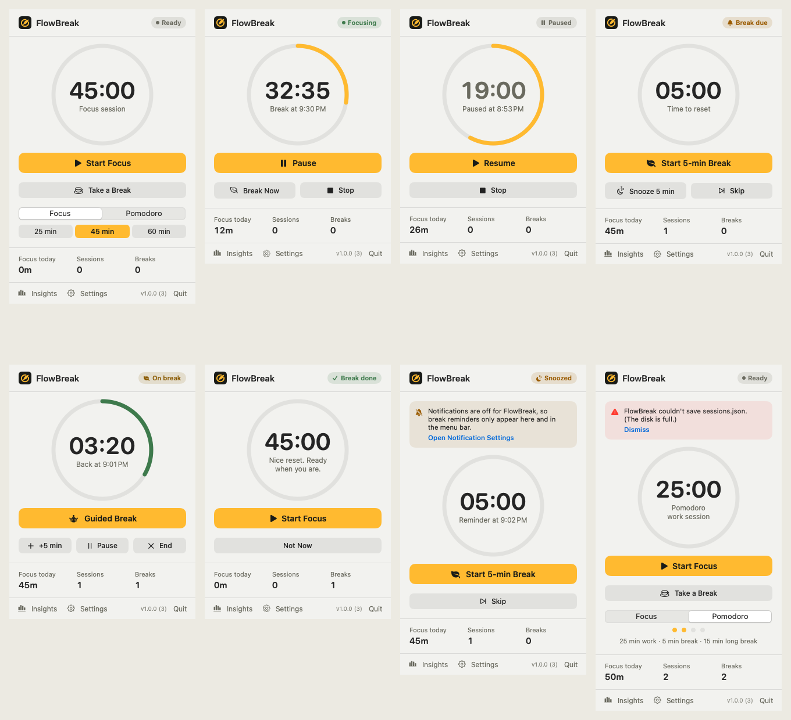
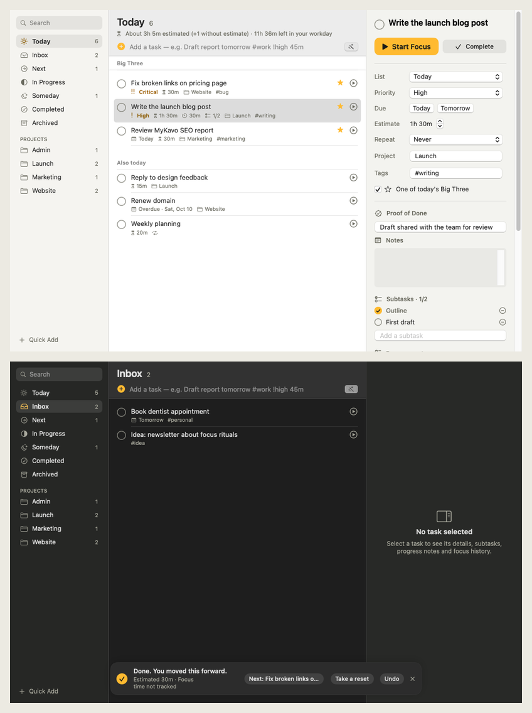
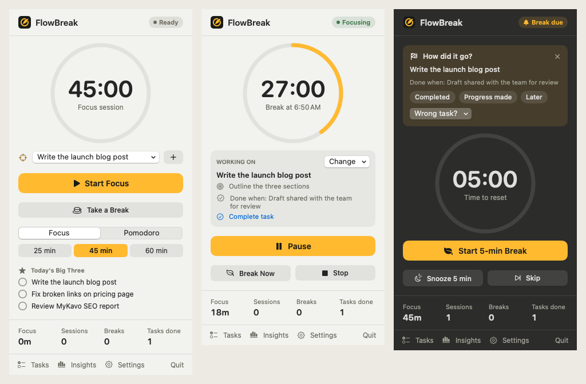
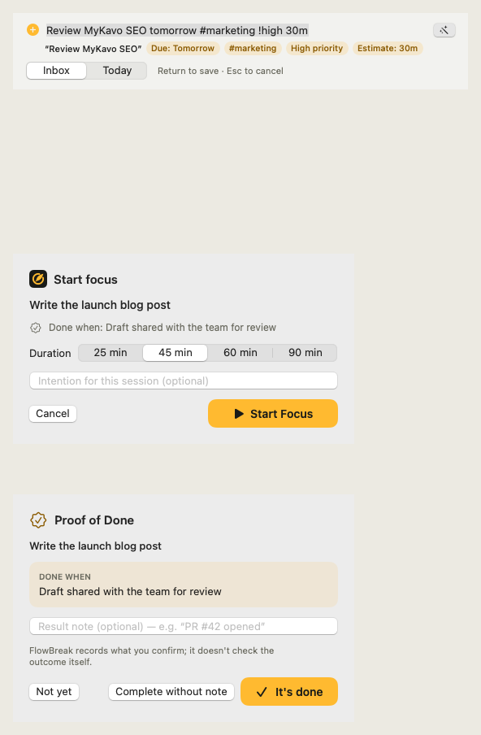
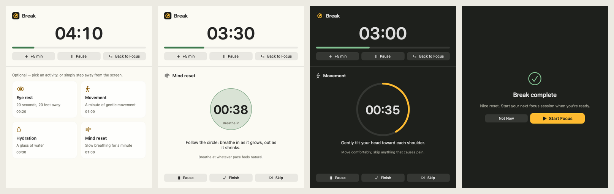
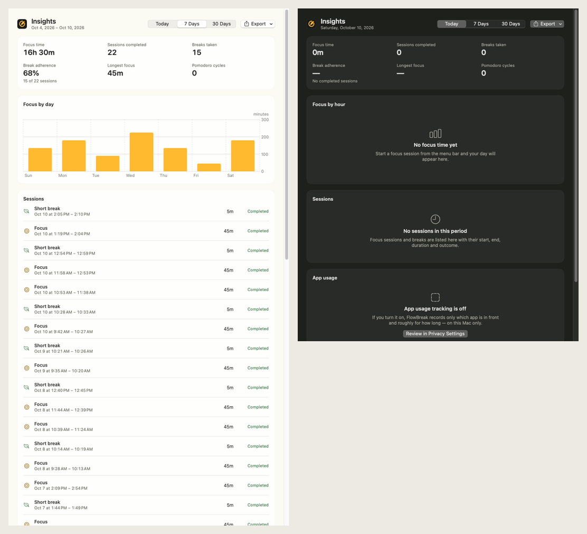
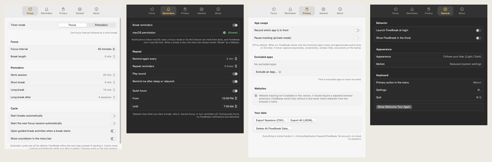
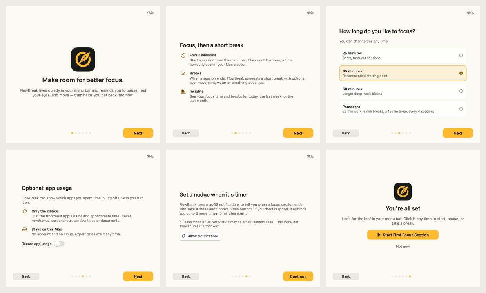

# FlowBreak

A calm, native macOS menu-bar app that helps you decide what matters, focus on it, take real breaks, and finish work with a clear sense of progress. Local-first, with no account, no cloud, and no analytics.



## Download

**[⬇︎ FlowBreak-unsigned.dmg](https://github.com/dakshu007/Productivity-Mac-App/releases/download/latest-build/FlowBreak-unsigned.dmg)** (from the [latest build release](https://github.com/dakshu007/Productivity-Mac-App/releases/tag/latest-build), rebuilt automatically on every push to the default branch). Open it and drag **FlowBreak** to **Applications**.

Every push also builds a DMG artifact. Open the newest run under **Actions → Build FlowBreak DMG** and download it from *Artifacts*. GitHub delivers artifacts as a `.zip` that contains the `.dmg`.

### First launch (unsigned development build)

CI builds are **ad-hoc signed and not notarized** because there's no Apple Developer ID in the repo yet. That's why the file name ends in `-unsigned`. macOS blocks the first launch of such apps:

- **macOS 15 Sequoia or later:** open FlowBreak once, dismiss the warning, then go to **System Settings → Privacy & Security**, scroll down and click **Open Anyway**.
- **macOS 13–14:** Control-click FlowBreak in Applications → **Open** → **Open**.
- Or in Terminal: `xattr -dr com.apple.quarantine /Applications/FlowBreak.app`

FlowBreak runs in the **menu bar** (top-right, a leaf inside an open circle). It has no Dock icon unless you enable one in Settings.

Requirements: macOS 13 Ventura or later. Universal binary for Apple Silicon and Intel.

## Screenshots

Rendered from the real app by CI (`FlowBreak --render-previews`). The full set, every state in light and dark, is attached to each release as `FlowBreak-screenshots.zip`.







| Guided break | Insights |
| --- | --- |
|  |  |




## Features

### Tasks (new in 1.1)

- **Quick Add from anywhere.** A floating panel accepts text like `Review MyKavo SEO tomorrow #marketing !high 30m +Website` and shows a preview of the due date, tags, priority, estimate and project before saving. Return saves, Escape cancels, and the app you were using stays in front. Smart parsing can be switched off. You can choose an optional global shortcut (⌥⌘T, ⌃⌥T or ⌃⌥Space); none is set by default.
- **Tasks window** with lists for Today, Inbox, Next, In Progress, Someday, Completed and Archived, plus a section per project. It also has search across titles, notes, Done-when, projects and `#tags`; drag-to-reorder; context menus; bulk complete, move and archive; and an inspector for priority, due date, estimate, repeat, project, tags, notes, link, subtasks, progress notes and focus history.
- **Daily Big Three.** Star up to three tasks for today. They appear at the top of Today and in the menu bar.
- **Focus on a task.** Choose a duration and an optional intention. The menu bar shows the task you're working on, and you can change the linked task mid-session.
- **"How did it go?"** After a session linked to a task, the menu bar asks for an outcome: *Completed*, *Progress made* (with an optional note), *Later*, or *Wrong task?* to relink the session. A timer ending never marks a task complete.
- **Flow Finish.** The checkbox fills amber and draws a checkmark (no animation with Reduce Motion), with an optional haptic. A toast reads "Done. You moved this forward." It compares your estimate with recorded focus time, or says "Focus time not tracked", and offers Undo, *Take a reset* and *Next task*.
- **Proof of Done.** Before starting, write what "done" means ("Email sent"). When completing, confirm it and add a result note if you like. FlowBreak records what you confirm; it doesn't check outcomes itself.
- **Recurring tasks** (daily, weekdays, weekly, monthly). The next instance is created once, even across relaunches.
- **Task insights:**
  - tasks completed
  - tasks worked on but still open
  - sessions per finished task
  - focus by task, with estimate vs. recorded time
  - focus by project
  - completions per day
- **Weekly review** with two optional reflection questions and a Markdown summary export.
- **Backup & restore.** One versioned JSON file. Restore validates the file, shows what it contains, and saves a safety copy first. You can also import a Markdown/text checklist and export tasks as Markdown or CSV.

### Focus & breaks

- **Menu-bar popover** with states for idle, focusing, paused, break due, on break, and break complete. Each state has one clear primary action. The menu-bar countdown is optional.
- **Reliable timer.** Sessions store absolute deadlines and are reconciled on every tick, on wake, on activation, and on relaunch. A session that ended while the Mac slept completes at its real deadline, exactly once. Pause captures the exact time left. If the clock is moved backwards, the session's remaining time is preserved.
- **Focus & Pomodoro.** Focus presets are 25, 45 (default) and 60 minutes, or a custom length. Pomodoro uses 25/5/15 with a long break every 4 sessions (configurable). Automatic cycles are opt-in and never chain through time the Mac was asleep.
- **Break reminders.** Native notifications offer *Take a break*, *Snooze 5 min* and *Dismiss*. A reminder repeats every 5 minutes up to 3 times by default (maximum 12). Other options: sound toggle, quiet hours, and a catch-up reminder after sleep or relaunch. Pending reminders are cancelled automatically when you act. If notifications are blocked, the menu bar shows **Break**.
- **Guided breaks.** Four activities: eye rest (20-20-20), gentle movement, hydration, and a breathing guide. Each has start, pause, finish and skip controls, and the breathing guide respects Reduce Motion.
- **Insights.** Choose Today, 7 days or 30 days to see focus time, sessions completed, breaks, break adherence, longest session, Pomodoro cycles, a chart, and a session timeline. Each metric explains how it's calculated, and sessions that cross midnight are split exactly. You can export to CSV or JSON.
- **Opt-in app usage.** Shows approximate time in the frontmost app, with exclusions, private mode, export and delete. See [PRIVACY.md](PRIVACY.md).
- **Onboarding, settings, launch at login, optional Dock icon, light/dark mode, VoiceOver labels.**

Not included in this version: website tracking, which needs a browser extension. The app says so rather than guessing websites from browser names.

## Build from source

Requires Xcode 15+ (Swift 5.9+) on macOS 13+.

```bash
swift test                      # unit tests for the timer engine, statistics, persistence, tracking
Scripts/build_app.sh            # → build/FlowBreak.app (this Mac's architecture, ad-hoc signed)
open build/FlowBreak.app

Scripts/build_universal.sh      # arm64 + x86_64
Scripts/build_dmg.sh            # → build/dmg/FlowBreak-<version>-unsigned.dmg (+ .sha256)
```

For quick iteration, `swift run FlowBreak` also works, but notifications and launch at login need the app bundle.

### Signed & notarized release

`Scripts/sign_and_notarize.sh` builds, signs with hardened runtime, packages, notarizes and staples. It refuses to run without credentials:

```bash
export DEVELOPER_ID_APPLICATION="Developer ID Application: Your Name (TEAMID)"
export NOTARY_PROFILE=flowbreak        # from: xcrun notarytool store-credentials
Scripts/sign_and_notarize.sh
```

In CI, add the repository secrets `DEVELOPER_ID_CERT_P12_BASE64`, `DEVELOPER_ID_CERT_PASSWORD`, `DEVELOPER_ID_APPLICATION`, `APPLE_ID`, `APPLE_TEAM_ID` and `APPLE_APP_PASSWORD`. The workflow then produces a signed, notarized `FlowBreak-<version>.dmg` without the `-unsigned` suffix.

### CI / releases

`.github/workflows/build.yml` runs on `macos-15` for every push and pull request. It:

1. Runs unit tests.
2. Builds the universal app.
3. Packages the DMG.
4. Mounts the DMG and smoke-tests the binary.
5. Uploads the DMG as an artifact.

Pushes to the default branch also update the **latest build** release. Pushing a `v*` tag, for example `git tag v1.0.0 && git push --tags`, creates a versioned release.

## Project layout

```text
Package.swift
Sources/FlowBreakCore/        Foundation-only logic (unit tested)
  Models/                     FocusSession, AppSettings
  Timer/                      EngineState, TimerEngine (single state machine)
  Reminders/                  ReminderPlanner (which notifications should be pending)
  Statistics/                 StatisticsCalculator (all metrics from session records)
  Tracking/                   UsageRecorder, UsageAggregator
  Persistence/                JSONFileStore, DataExporter
Sources/FlowBreak/            macOS app (AppKit shell + SwiftUI views)
  App/                        entry point, AppDelegate, AppModel, WindowCoordinator
  DesignSystem/               colour tokens, typography, spacing, logo renderer, components
  Features/                   MenuBar, Breaks, Insights, Settings, Onboarding
  Services/                   notifications, settings store, launch at login, app usage tracker
Tests/FlowBreakCoreTests/     XCTest suites
Resources/                    Info.plist, AppIcon.icns, entitlements
Design/                       logo/icon SVG sources, 1024px icon, preview sheet
Scripts/                      build_app, build_universal, build_dmg, sign_and_notarize, generate_icons.py
docs/SPEC.md                  product & engineering specification
```

## Design

The logo is an open ring (the "flow") with a leaf sprouting through its gap, meaning a small reset and a return to focus. The colours are amber `#FFBA30` on ink `#191B18`, with warm off-white `#FBFAF3`. All brand assets are rendered from one geometric definition by `Scripts/generate_icons.py`. The same geometry is drawn natively by `LogoRenderer.swift` for the menu-bar template image and in-app marks.

## Documented behaviours

- Taking a break during focus ends that focus session as *ended early*. Its minutes count toward focus time, but it isn't counted as a completed session.
- Starting focus while a break is due skips that break. Starting focus during a break ends the break early.
- Break adherence = completed focus sessions followed by a break ÷ completed focus sessions.
- Days use the Mac's current calendar and time zone.
- If the wall clock jumps forward, FlowBreak can't tell that apart from sleep, so the jump counts as elapsed time.

## Status

See [docs/STATUS.md](docs/STATUS.md) for what is verified, what is not, and the signing status.

## License

MIT. See [LICENSE](LICENSE).
